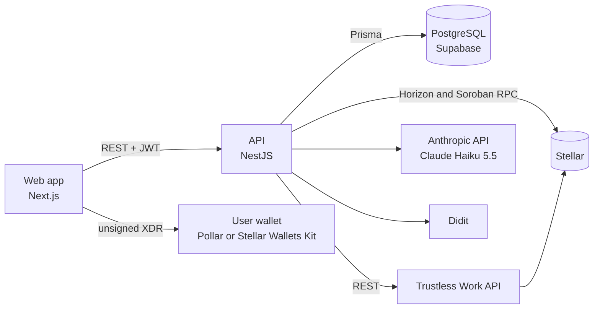

# Pocket

**A marketplace where startups hire growth, sales and marketing specialists and pay them through USDC milestone escrows on Stellar.**

[](https://github.com/POCKET-XYZ/Pocket/actions/workflows/ci.yml)


[Website](https://pocketgrowth.xyz) · [App](https://app.pocketgrowth.xyz) · [Testnet](https://testnet.pocketgrowth.xyz) · [Stats](https://app.pocketgrowth.xyz/stats) · [Documentation](docs/) · [Security](SECURITY.md)

## Overview

Many early-stage startups in Latin America have strong technical teams and nobody dedicated to growth. Pocket connects them with specialists who are paid by results: the startup locks the budget in an escrow when the work starts, and each milestone is released only when the startup approves the delivery. The startup never pays for nothing, and the specialist never works for free.

Pocket has been live on Stellar mainnet since November 3, 2026. The app is in Spanish, built for Latin America.

## Features

**For startups**

- Post a job with milestones, amounts and measurable KPIs, or save it as a draft and post it later.
- Draft the job post with the Pocket assistant, which suggests a title, a description, milestones and KPIs from the startup's own templates.
- Compare applicants by their profile and verified track record, and hire at the asked price or with a counteroffer.
- Fund the escrow in USDC, approve each delivery or ask for changes, and open a dispute when needed.
- Follow results on a dashboard, and download PDF and CSV reports with every payment linked to its Stellar transaction.

**For specialists**

- A standardized public profile with a track record built only from paid work: jobs completed, on-time rate and KPI attainment.
- Content creators also list their social accounts and audience.
- Deliver each milestone with its KPI results, and get paid in USDC as soon as the startup approves it.
- Turn delivery notes into a report organized by the contract's KPIs, with the assistant.

**Platform**

- Sign in with email or Google through [Pollar](https://pollar.xyz), which creates the user's Stellar wallet, or with a wallet such as Freighter.
- Identity checks through [Didit](https://didit.me): startups before they use Pocket, specialists before they accept a contract.
- A chat for every contract.
- Disputes resolved by Pocket's team, with each party's share paid on chain.
- A public [stats page](https://app.pocketgrowth.xyz/stats) with Pocket's traction read from Stellar: escrows, USDC funded and released, fees collected and repeat hires.

## How a hire works

1. **Post.** A startup posts a job with its milestones, amounts and KPI targets.
2. **Hire.** Specialists apply, and the startup picks one, at the asked price or with a counteroffer.
3. **Fund.** Once the specialist accepts, Pocket deploys a multi-release escrow through [Trustless Work](https://www.trustlesswork.com/) and the startup funds it in USDC.
4. **Deliver.** The specialist delivers each milestone with its results. The startup approves it or asks for changes.
5. **Get paid.** An approved milestone is released to the specialist. If the parties disagree, either one can open a dispute, and Pocket's team resolves it by paying each party its share.

Each release and each dispute resolution pays **1% to Pocket** and **0.3% to Trustless Work**. The rest goes to the specialist, or to the startup for its share of a dispute.

### Custody

Funds sit in one escrow contract per hire, never in a Pocket account. Users sign their own operations (funding, approving, disputing) with their own wallet. Pocket's platform account is each escrow's release signer and dispute resolver, and it signs only the exact contract call, with the exact arguments, that Pocket asked for. See [docs/escrow.md](docs/escrow.md) and [docs/security.md](docs/security.md).

## Architecture



The web app has the user's wallet sign each transaction and sends it back to the API, which checks it against the one it prepared and submits it. Every step counts only once the escrow, read back from the chain, shows it happened. Details in [docs/architecture.md](docs/architecture.md).

## Tech stack

| Layer      | Technology                                                    |
| ---------- | ------------------------------------------------------------- |
| Web        | Next.js 16, React 19, Tailwind CSS 4                          |
| API        | NestJS 11, Prisma 6                                           |
| Database   | PostgreSQL on Supabase                                        |
| Blockchain | Stellar (Soroban), USDC, Stellar SDK                          |
| Escrow     | Trustless Work multi-release escrows                          |
| Wallets    | Pollar (email and Google sign-in), Stellar Wallets Kit        |
| Identity   | Didit                                                         |
| Assistant  | Claude Haiku 5.5 through Anthropic's API                      |
| Email      | Resend                                                        |
| Monitoring | Sentry, security alerts to Discord, uptime checks             |
| Hosting    | Railway (API), Vercel (web and landing)                       |
| Tooling    | Bun workspaces, Turborepo, TypeScript, Jest, ESLint, Prettier |

## Environments

|         | Mainnet                                              | Testnet                                                      |
| ------- | ---------------------------------------------------- | ------------------------------------------------------------ |
| Web app | [app.pocketgrowth.xyz](https://app.pocketgrowth.xyz) | [testnet.pocketgrowth.xyz](https://testnet.pocketgrowth.xyz) |
| Money   | Real USDC                                            | Test USDC                                                    |

The landing page is at [pocketgrowth.xyz](https://pocketgrowth.xyz) and the mainnet API at `api.pocketgrowth.xyz`. Every merge to `main` deploys both environments. Each one has its own database, Pollar app, Trustless Work API and platform account; nothing is shared between them. See [docs/mainnet.md](docs/mainnet.md).

## Repository structure

```
Pocket/
├── apps/
│   ├── api/          NestJS REST API: accounts, jobs, contracts, escrow, reports, assistant
│   ├── web/          Next.js web app
│   └── landing/      Next.js landing page (pocketgrowth.xyz)
├── packages/
│   └── shared/       Enums, fees and API types shared by the API and the web app
├── docs/             Engineering documentation
└── .github/          CI, uptime checks and Dependabot
```

## Getting started

### Prerequisites

- [Bun](https://bun.sh) 1.4 or later
- Node.js 22 or later
- A PostgreSQL database (a [Supabase](https://supabase.com) project)
- A [Trustless Work](https://www.trustlesswork.com/) API key for testnet
- A Stellar testnet account for the platform, funded with XLM

### Install and configure

```bash
git clone https://github.com/POCKET-XYZ/Pocket.git
cd Pocket
bun install

cp apps/api/.env.example apps/api/.env
cp apps/web/.env.example apps/web/.env.local
cp apps/landing/.env.example apps/landing/.env.local
```

The API refuses to start without `DATABASE_URL`, `DIRECT_URL`, `JWT_SECRET` (at least 32 random characters), `TRUSTLESS_WORK_API_URL`, `TRUSTLESS_WORK_API_KEY`, `TRUSTLESS_WORK_DEPLOYER_CONTRACT_ID`, `TRUSTLESS_WORK_ESCROW_WASM_HASH`, `USDC_ISSUER` and `STELLAR_PLATFORM_SECRET`, plus `TRUSTLESS_WORK_FEE_ADDRESS` on testnet. Pollar, Didit, Resend, Sentry and the assistant stay off until their keys are set. The comments in each `.env.example` explain every variable.

### Set up the database and the platform account

```bash
cd apps/api
bun run db:deploy        # apply the migrations
bun run db:seed          # managers from MANAGER_STELLAR_ADDRESSES
bun run stellar:setup    # once per network: the platform account trusts USDC
cd ../..
```

### Run

```bash
bun run dev
```

Turborepo starts every app:

| App     | URL                                                                      |
| ------- | ------------------------------------------------------------------------ |
| API     | http://localhost:3000/api (Swagger UI at http://localhost:3000/api/docs) |
| Web     | http://localhost:3001                                                    |
| Landing | http://localhost:3002                                                    |

## Scripts

Run from the repository root:

| Command               | What it does                      |
| --------------------- | --------------------------------- |
| `bun run dev`         | Starts every app in watch mode    |
| `bun run build`       | Builds every app and package      |
| `bun run test`        | Runs the unit tests               |
| `bun run lint`        | Lints every app                   |
| `bun run typecheck`   | Type-checks every app and package |
| `bun run db:generate` | Generates the Prisma client       |
| `bun run format`      | Formats the code with Prettier    |

In `apps/api`: `db:migrate` creates a migration, `db:studio` opens Prisma Studio, and `stellar:preflight` checks a network's configuration before going live.

## Testing and CI

Every pull request and every push to `main` runs, on GitHub Actions:

- lint, type checks, unit tests and the build;
- a dependency audit (`bun audit`), also every Monday for new advisories;
- a secret scan of the full history with gitleaks.

A separate workflow checks that the API, the app and the landing page are up, and alerts the team on Discord when one is not.

## Documentation

| Document                                 | Covers                                                     |
| ---------------------------------------- | ---------------------------------------------------------- |
| [Architecture](docs/architecture.md)     | Components, the signing flow and the API layout            |
| [Authentication](docs/authentication.md) | Wallet and Pollar sign-in, and access tokens               |
| [Verification](docs/verification.md)     | Account details and identity checks with Didit             |
| [Profiles](docs/profiles.md)             | The startup and specialist templates                       |
| [Jobs](docs/jobs.md)                     | Jobs, drafts and applications                              |
| [Contracts](docs/contracts.md)           | Hiring, milestones, deliveries and disputes                |
| [Escrow](docs/escrow.md)                 | Escrow roles and how the money moves                       |
| [Reports](docs/reports.md)               | Results reports, KPI targets and payouts read from Stellar |
| [Assistant](docs/assistant.md)           | The Pocket assistant, its limits and its spend             |
| [Pollar](docs/pollar.md)                 | Email and Google sign-in, wallet activation                |
| [Mainnet](docs/mainnet.md)               | Going live on mainnet, step by step                        |
| [Security](docs/security.md)             | Threats, controls, monitoring and the incident plan        |

## Security

Pocket moves real money. Please report vulnerabilities privately as described in [SECURITY.md](SECURITY.md), and never test against mainnet funds or other users' accounts.
